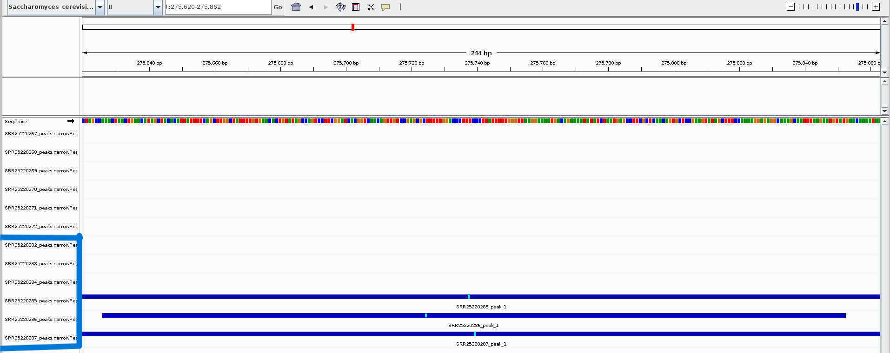
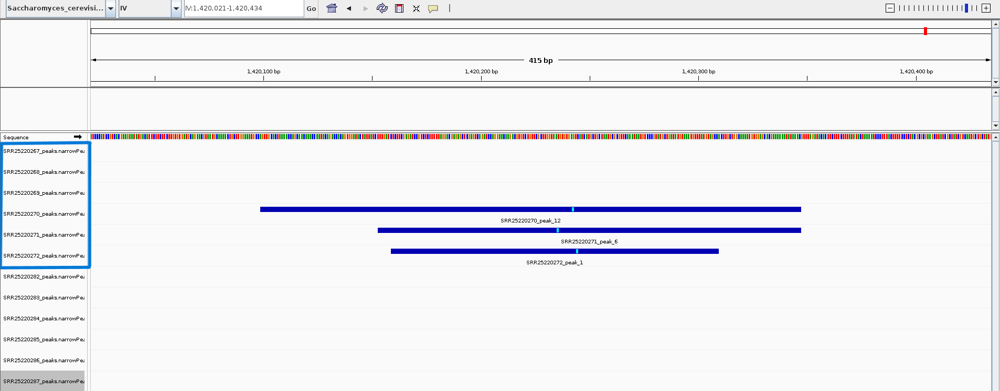

# Assignment 10

## Overview

This workflow processes ChIP-seq sequencing data from *Saccharomyces cerevisiae* to identify GAL4 and GCN4 transcription factor binding sites using matched case/control comparisons.

The pipeline automates:

1. Reference genome and annotation retrieval.
2. SRA FASTQ download.
3. Paired-end read alignment using BWA.
4. BAM sorting and indexing using SAMtools.
5. Matched case/control peak calling using MACS3.
6. Peak tracking and IGV session generation for visualization.

Sample metadata, including SRA accessions, transcription factors, and treatment assignments, are maintained in a single design file (`design.csv`). The workflow dynamically discovers samples and constructs matched case/control comparisons from this file.

## 1. Project organization

The project directory should contain the following files:

```text
project/
├── Makefile
├── design.py
├── design.csv
├── ref_genome/
├── peaks/
└── SRR_ACCESSION/
    ├── fastq/
    └── bam/
```

The `design.csv` file defines the samples and their experimental assignments.

## 2. Experimental design

The sample metadata file contains the following columns:

| Column | Description |
|---|---|
| Run | SRA accession |
| TranscriptionFactor | Target transcription factor |
| Organism | Reference organism |
| Sample Name | GEO sample accession |
| SRA Study | SRA study accession |
| treatment | Experimental condition and replicate |

The provided experiment contains 24 sequencing runs:

| Transcription factor | Case replicates | Control replicates |
|---|---|---|
| GCN4 | 6 | 6 |
| GAL4 | 6 | 6 |

Biological replicates are matched by their replicate identifiers. For example, `GCN4_case1` is compared with `GCN4_control1` and `GAL4_case1` is compared with `GAL4_control1`.

The `design.py` script parses this file and dynamically generates the sample list and case/control comparisons. 

## 3. Reference genome preparation

The workflow retrieves the *Saccharomyces cerevisiae* reference genome and corresponding GFF3 annotation from **Ensembl** Fungi. The downloaded reference genome and annotation are stored in:

```text
ref_genome/
├── Saccharomyces_cerevisiae.R64-1-1.dna.toplevel.fa
├── Saccharomyces_cerevisiae.R64-1-1.62.gff3
└── index/
    └── sacCer3.*
```

## 4. Sample processing and read alignment

The number of sequencing spots retrieved per sample is controlled using the `N` parameter. The default value is 140,000.

Paired-end reads are generated using:

```bash
fastq-dump -X 140000 --split-files SRR_ACCESSION
```

To process all samples, execute:

```bash
make batch N=140000 THREADS=4 JOBS=2
```

Here:

- `N` specifies the maximum number of sequencing spots retrieved per sample.
- `THREADS` specifies the number of computational threads allocated to individual alignment jobs.
- `JOBS` specifies the number of samples processed concurrently.

The FASTQ and BAM files are organized by SRA accession:

```text
SRR_ACCESSION/
├── fastq/
│   ├── SRR_ACCESSION_1.fastq
│   ├── SRR_ACCESSION_2.fastq
│   └── .spots-140000.complete
└── bam/
    ├── SRR_ACCESSION.bam
    └── SRR_ACCESSION.bam.bai
```

## 5. Matched case/control peak calling

Peak calling is performed using MACS3.

Each case sample is compared against its corresponding control sample, as defined by the experimental design.

The workflow uses the following MACS3 parameters:

```bash
macs3 callpeak \
    -t CASE.bam \
    -c CONTROL.bam \
    -f BAMPE \
    -n SAMPLE \
    -g 1.2e7 \
    -q 0.01 \
    --outdir peaks/TRANSCRIPTION_FACTOR
```

Parameter descriptions:

| Parameter | Description |
|---|---|
| `-t` | Treatment (case) BAM file |
| `-c` | Matched control BAM file |
| `-f BAMPE` | Paired-end BAM input |
| `-n` | Output sample identifier |
| `-g 1.2e7` | Approximate effective genome size for *S. cerevisiae* |
| `-q 0.01` | False discovery rate threshold |
| `--outdir` | Output directory |

The effective genome size is set to approximately 12 million bases.

Peak calling is performed independently for each matched biological replicate.

To execute the complete alignment and peak-calling workflow:

```bash
make PEAKS N=140000 THREADS=4 JOBS=2
```

Peak files are organized by transcription factor:

```text
peaks/
├── GCN4/
│   ├── SRR25220267_peaks.narrowPeak
│   ├── SRR25220267_summits.bed
│   ├── SRR25220268_peaks.narrowPeak
│   └── SRR25220268_summits.bed
└── GAL4/
    ├── SRR25220282_peaks.narrowPeak
    ├── SRR25220282_summits.bed
    ├── SRR25220283_peaks.narrowPeak
    └── SRR25220283_summits.bed
```

MACS3 also generates additional output files, including peak annotation tables and model information where applicable.

## 6. IGV visualization

The workflow includes an automated IGV target that discovers MACS3 peak files and prepares a session containing the corresponding case BAM files, control BAM files, and peak tracks.

The IGV manifest is generated automatically from the design file and available peak files.

To generate and launch the IGV session, execute:

```bash
make IGV N=140000 THREADS=4 JOBS=2
```

The workflow generates:

```text
peaks/
├── igv_manifest.tsv
└── igv_session.xml
```

The manifest records the matched case/control samples, their BAM files, and associated peak files.

The generated IGV session is used to load the reference genome and associated alignment and peak tracks for visual inspection.

**GAL4 binding on chr 2**

**GLN4 binding on chr 4**


Both GLN4 and GAL4 bind to different regions in the genome.


## 7. Complete workflow execution

The entire analysis can be initiated with a single command:

```bash
make IGV \
    DESIGN=design.csv \
    N=140000 \
    THREADS=4 \
    JOBS=2
```


## 8. Expected final results

The final output consists of:

1. Reference genome and annotation files.
2. Paired-end FASTQ files for all eight sequencing runs.
3. Sorted and indexed BAM files for all eight samples.
4. Alignment quality-control statistics.
5. MACS3 peak calls for four matched case/control comparisons.
6. An IGV manifest and session for visualization.

This workflow provides a reproducible framework for comparing GCN4 and GAL4 transcription factor binding across matched case/control biological replicates in *Saccharomyces cerevisiae*.
