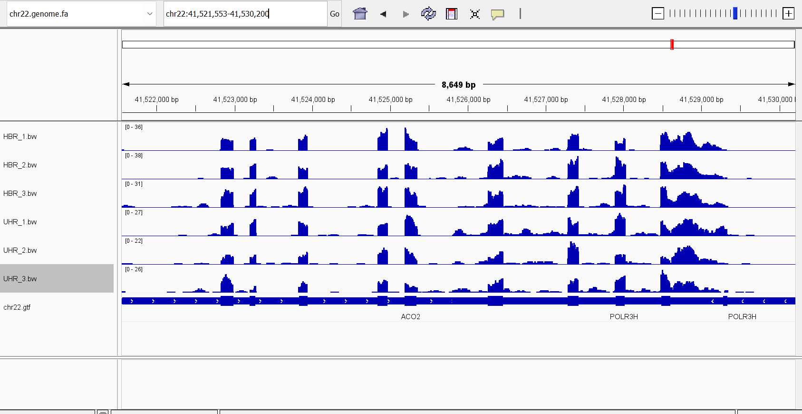
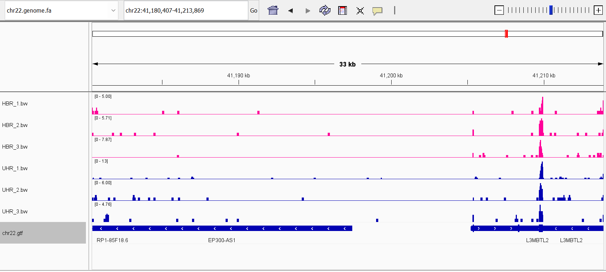
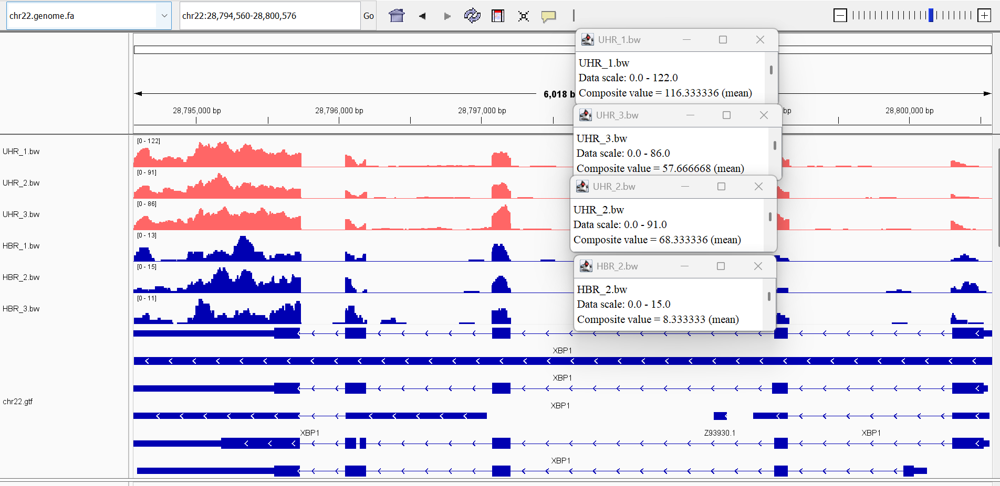
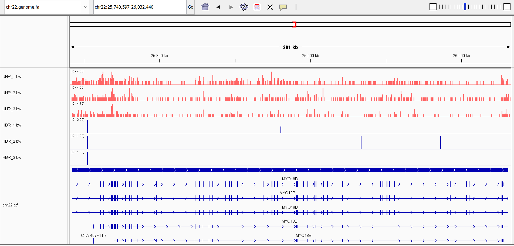

# Assignment 11

## The files were downloaded correctly.

`$ tree`

```
.
|-- README.md
|-- design.csv
|-- fasta
|   |-- chr22.genome.fa
|   `-- chr22.transcripts.fa
|-- fastq
|   |-- HBR_1_R1.fq
|   |-- HBR_2_R1.fq
|   |-- HBR_3_R1.fq
|   |-- UHR_1_R1.fq
|   |-- UHR_2_R1.fq
|   `-- UHR_3_R1.fq
`-- gtf
    `-- chr22.gtf

4 directories, 11 files
```

`$ seqkit stats fasta/*.fa`

```
file                        format  type  num_seqs     sum_len     min_len     avg_len     max_len
fasta/chr22.genome.fa       FASTA   DNA          1  50,818,468  50,818,468  50,818,468  50,818,468
fasta/chr22.transcripts.fa  FASTA   DNA      4,506   7,079,970          33     1,571.2      84,332
```


`$ seqkit stats fastq/*.fq`


```
file               format  type  num_seqs     sum_len  min_len  avg_len  max_len
fastq/HBR_1_R1.fq  FASTQ   DNA    118,571  11,857,100      100      100      100
fastq/HBR_2_R1.fq  FASTQ   DNA    144,826  14,482,600      100      100      100
fastq/HBR_3_R1.fq  FASTQ   DNA    129,786  12,978,600      100      100      100
fastq/UHR_1_R1.fq  FASTQ   DNA    227,392  22,739,200      100      100      100
fastq/UHR_2_R1.fq  FASTQ   DNA    162,373  16,237,300      100      100      100
fastq/UHR_3_R1.fq  FASTQ   DNA    185,442  18,544,200      100      100      100
```


`make batch THREADS=4 JOBS=2`


## Output



## Questions to answer
- Look at a wide region (millions of bases wide). How are the two sample types different?
    > comparing the .bw files between HBR snd UHR samples between 41,521,553-41,530,200 on chromosome 22, shows that the expression between the two sample types is fairly similar.

- Navigate across the genome. How consistent are the replicates?
    > The larger peaks tend to be more consistent across the replicates, but the smaller peaks are less consistent.

- Find a gene that is not expressed in any of the samples.
    > EP300-AS1 is not expressed


- Find a gene that is very strongly expressed in all samples. What is its coverage?
    > </br>
    > The coverage of XBP1 is high in both groups. In the UHR group it is a lot higher than in HBR but it is still high in both. 

- Can you identify the transcripts that are expressed? Sometimes you can only exclude some candidates.
    > For XBP1 I, can since there is ver little overlap with other genes. It is being expressed on the reverse strand.


- Can you find a gene/transcript where the expression is clearly different between the two sample types? What is the fold change?
    > </br>
    > If I was to use the average of the maximum values for UHR it woud be (4+4+4.72)/3=4.24 and for HBR it would be (1+1+2)/3=4/3. The logFC would be ln(UHR/HBR)=ln(4.24/(4/3))=1.16


- Is the transcript upregulated or downregulated?
    > Since the logFC is above 1, it is upregulated in UHR compared to HBR.


- How certain are you that it is not a random fluctuation? Why?
    > Since the expression patterns is the same for each replicate in each group I am fairly certain this is not the result of random fluctuations.


