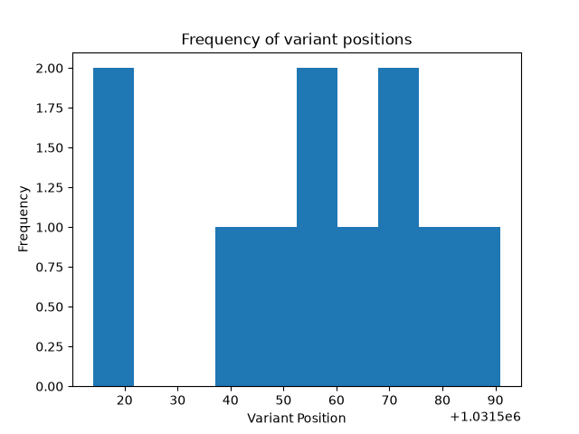
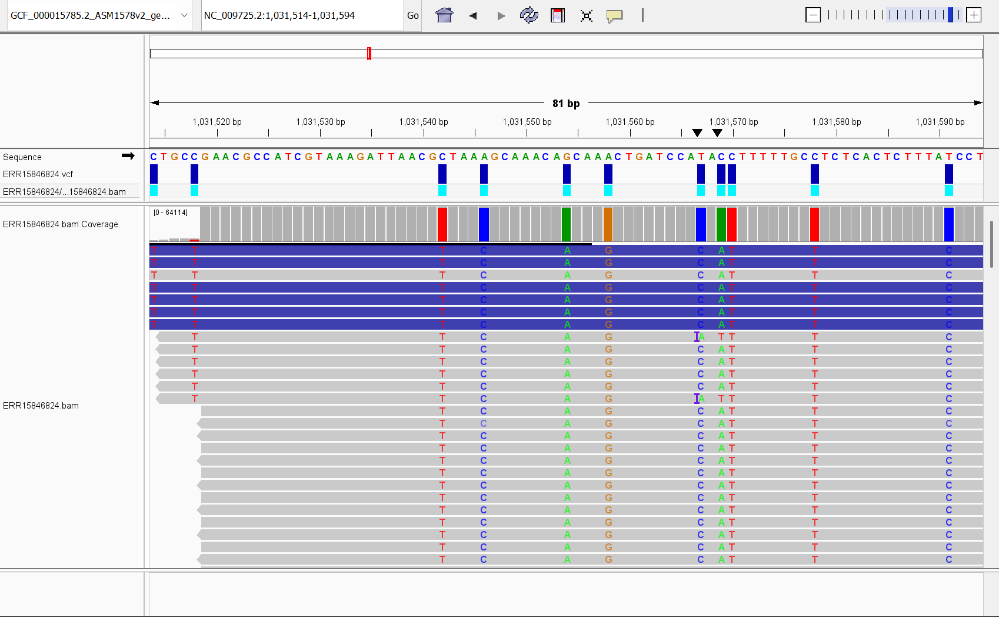

# Assignment 7

## Ensure that you get at least 10x coverage of the genome.

The SRA experiment I am using is **ERR15846824** ("Bacillus subtilis subsp. subtilis str. 168") which was sequenced using Illumina HiSeq 2500 which tends to generate reads of length 300 bases (or 600 bases for paired end reads). The genome size for my reference, "Bacillus velezensis FZB42", is 3.9Mb. The equation for coverage is:

$coverage = \frac{read\\_length * num\\_reads}{genome\\_size}$

so to get the total number of reads for 10x coverage at a read length of 600 I would use:

$$
num\_reads = \frac{genome\\_size * coverage}{read\\_length}
= \frac{3,918,596*10x}{600} = 65,309.9333
$$

For paired ends I will do do $65,309.9333/2=32654.9667$ or $32655$ since I am using paired end reads.

Since I am doing paired end reads, each spot corresponds to 2 reads so I will use `fastq-dump -X 32655` or in my make file `-N 32655`

## Write a Makefile that calls variants and creates a VCF file.
Run using `make`

## Run a statistics report on the VCF file.
Reference-Sample SNP substitution count:
{'C-T': 5, 'A-C': 1, 'G-A': 1, 'A-G': 1, 'T-C': 2, 'C-A': 1}

The most common substitution between the reference and sample is a C to T and there are 11 SNPs. 

From the image of variant positions and frequencies, it is clear that most of the variants tend to cluster together since they exist between positions 1031514 and 1031591. 

## Visualize the VCF file in IGV.

