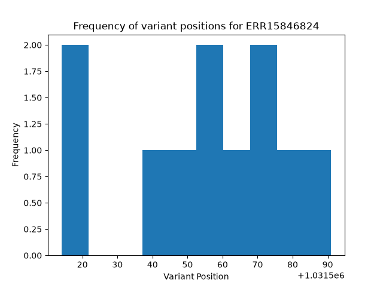
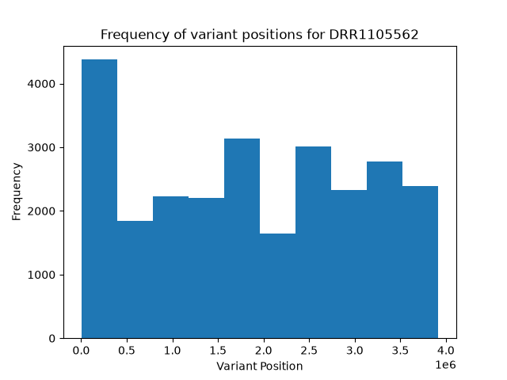
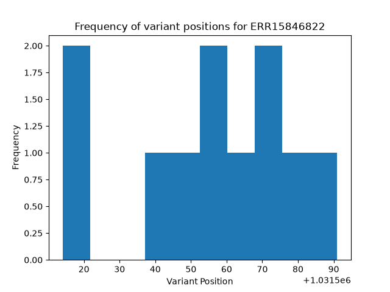
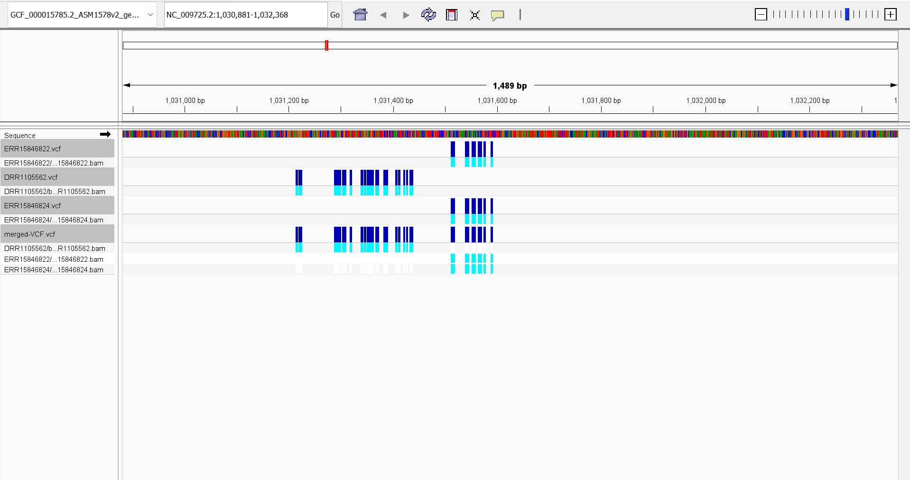
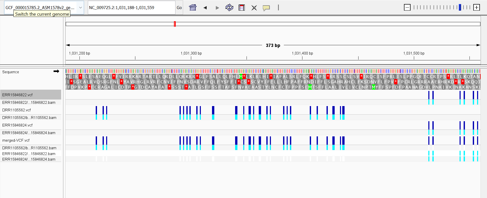

# Assignment 8

## Determining coverage (10x)
$coverage = \frac{read\\_length * num\\_reads}{genome\\_size}$


- ERR15846824 ("Bacillus subtilis subsp. subtilis str. 168")
Sequenced on Illumina MiSeq which tends to generate reads of length 300 bases (or 600 bases for paired end reads)

- DRR1105562 ("Bacillus subtilis subsp. subtilis str. 168")
Sequenced on Illumina HiSeq 2500 which tends to generate reads of length 300 bases (or 600 bases for paired end reads)

- ERR15846822 ("Bacillus subtilis subsp. subtilis str. 168")
Sequenced on Illumina MiSeq which tends to generate reads of length 300 bases (or 600 bases for paired end reads)


For all three samples I will use the formula: </br>
$$
num\_reads = \frac{genome\\_size * coverage}{read\\_length}
= \frac{3,918,596*10x}{600} = 65,309.9333
$$
For paired ends I will do do $65,309.9333/2=32654.9667$ or $32655$ since I am using paired end reads.</br></br>
Since I am doing paired end reads, each spot corresponds to 2 reads so I will use `fastq-dump -X 32655` or in my make file `-N 32655`

## Make file

### parameters:
-   GENOME_URL - the URL of the reference genome
    - default: https://ftp.ncbi.nlm.nih.gov/genomes/all/GCF/000/015/785/GCF_000015785.2_ASM1578v2/GCF_000015785.2_ASM1578v2_genomic.fna.gz

- SRR_ID - the SRR id of the sample
    - default: ERR15846824

- N - number of spots for fastq dump
    - default: 32655

- REF_FILE - file name of the reference genome
    - default: GCF_000015785.2_ASM1578v2_genomic.fna

- MERGE - merge all the found vcf files
    - default: 0 (to merge the vcf files use MERGE=1)

```bash
make SRR_ID=ERR15846824
make SRR_ID=DRR1105562
make SRR_ID=ERR15846822 MERGE=1
```


## Visualizing the variants
**ERR15846824**:



**DRR1105562**




**ERR15846822**



ERR15846822 and ERR15846824 have exactly the same variant positions. They are both part of the same study and bioproject (PRJEB102831) which may explain this lack of variation. Interestingly, DRR1105562 has variants all throught the sample.


## IGV






From this we can see that the three "Bacillus subtilis subsp. subtilis str. 168" species have a high level of agreement as to what the variants are. Although DRR1105562 has high levels of overlap with ERR15846822 and ERR15846824, there is some distinction which could be due to technical variation in sequencing due to being processed in a different labratory. 