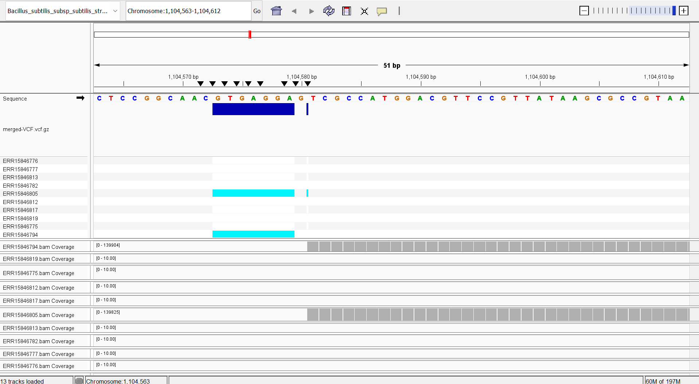

# Assignment 9

This directory contains a Makefile workflow for downloading paired-end reads
from SRA, aligning them to the *Bacillus subtilis* subsp. *subtilis* strain 168
reference, calling variants with bcftools, and merging per-run calls into a
multi-sample VCF.


## Study and sample design

[`design.csv`](./design.csv) lists ten paired-end genomic-DNA runs from
BioProject PRJEB102831. The project studies how long-range mRNA folding relates
to bacterial gene expression and sequence. These runs were selected from the
project's SRA/ENA metadata; transcriptomic runs were excluded because RNA-seq
is not the intended input for this genomic variant-calling workflow.

The CSV columns are:

| Column | Meaning | Used by the Makefile |
| --- | --- | --- |
| `Run` | SRA run accession used to retrieve the reads | Yes; the batch target passes it as `SRR_ID` |
| `Sample` | Readable sample label | No; documentation/metadata only |
| `Group` | Readable sample group | No; documentation/metadata only |
| `BioProject` | Source BioProject accession | No; documentation/metadata only |

The run accession is also used as the sample name in its VCF. The default
workflow uses 140,000 paired-end spots per run. With two 150-base reads per
spot and a 4.2 Mb genome, this is approximately 10x nominal sequence depth:

```text
140,000 spots x 2 reads/spot x 150 bases/read / 4,200,000 bases ~= 10x
```

Actual depth depends on read length, filtering, and mapping. `N` is the maximum
spot number requested from `fastq-dump`, not the number of individual reads.


## Quick start: run all ten samples

```bash
make batch
```

This is the normal end-to-end command. It:

1. Ensures the reference genome and annotation files exist.
2. Builds the shared BWA index if it is missing.
3. Reads each run accession from the `Run` column of `design.csv`.
4. Uses GNU parallel to run the single-sample workflow for each run.
5. Merges all per-run VCFs into one indexed, multi-sample VCF.

The default resource settings are `N=140000`, `THREADS=2`, and `JOBS=2`.
Override them on the command line as needed:

```bash
make batch JOBS=2 THREADS=2 N=140000
```

- `JOBS` is the number of sample workflows GNU parallel runs at the same time.
- `THREADS` is passed to BWA and SAMtools for each sample. Total CPU use can
  approach `JOBS x THREADS` threads.
- `N` is the requested maximum number of SRA spots per run.
- `DESIGN` selects a design CSV; by default it is `design.csv`.

For example, to use another design file:

```bash
make batch DESIGN=pilot_design.csv JOBS=1 THREADS=2 N=50000
```

The design file must have a header containing `Run`, followed by one run
accession per row. `Sample`, `Group`, and `BioProject` are useful descriptive
columns, but only `Run` controls which data the Makefile processes.

## Run one sample

The single-sample workflow is the building block used by `batch`. By default,
`SRR_ID` is `ERR15846824`:

```bash
make all
```

Choose a different run or spot limit with command-line Make variables:

```bash
make all SRR_ID=ERR15846776 N=140000 THREADS=2
```

`all` is the default end-to-end single-sample target. It ensures the reference
is present, then builds the sample's FASTQs, alignment, and VCF through their
file dependencies. Run-specific outputs are placed under a directory named
for `SRR_ID`.

## Make targets, in detail

The Makefile exposes the following targets. Target names are case-sensitive.

### `all`

```bash
make all SRR_ID=ERR15846776 N=140000 THREADS=2
```

Runs the reference target and builds that run's compressed VCF. The VCF depends
on the sorted/indexed BAM; the BAM depends on the FASTQs and the shared BWA
index. Make skips output files it considers up to date.

### `GENOME`

```bash
make GENOME
```

Downloads and decompresses the reference FASTA and GFF3 annotation into
`ref_genome/` when the files are missing. `GENOME_URL`, `ANNOTATION_URL`,
`REF_FILE`, and `ANN_FILE` can be overridden if using different reference
files. The reference FASTA must match the annotation and the samples being
analyzed.

### `FASTQs`

```bash
make FASTQs SRR_ID=ERR15846776 N=140000
```

Creates `<SRR_ID>/fastq/` and runs:

```bash
fastq-dump -X <N> --split-files <SRR_ID> --outdir <SRR_ID>/fastq
```

The expected outputs are `<run>_1.fastq` and `<run>_2.fastq`. The Makefile
checks whether both existing files contain the requested number of spots and
records that setting in a `.spots-<N>.complete` stamp. If the files do not
match, it removes the two FASTQs and downloads them again. `seqkit stats`
reports the read counts and lengths.

To force a fresh download at the same spot limit, remove only that run's
`fastq/` directory, then run the target again. Do not delete other project
directories to refresh FASTQs.

### `INDEX`

```bash
make INDEX
```

Builds a shared BWA index from the reference FASTA, using prefix
`ref_genome/index/bsubtilis168`. It is shared by all samples; each run does not
need its own copy.

### `ALIGN`

```bash
make ALIGN SRR_ID=ERR15846776 N=140000 THREADS=2
```

Aligns the paired FASTQs with `bwa mem`, adds a read group/sample identifier,
sorts the alignments with `samtools sort`, and indexes the BAM with
`samtools index`. `samtools flagstat` prints alignment statistics.

Outputs:

```text
<run>/bam/<run>.bam
<run>/bam/<run>.bam.bai
```

### `VARIANTS`

```bash
make VARIANTS SRR_ID=ERR15846776 N=140000 THREADS=2
```

Uses bcftools to pile up read evidence from the BAM, call variants as haploid
(`--ploidy 1`), normalize alleles against the reference, remove duplicate
records, and write a compressed, indexed VCF. The mpileup depth is capped at
50 reads per position per sample.

Outputs:

```text
<run>/vcf/<run>.vcf.gz
<run>/vcf/<run>.vcf.gz.csi
```

### `batch`

```bash
make batch
```

Builds the shared reference/index, then runs `make all` for every `Run` in the
design CSV using GNU parallel. Once all sample commands finish successfully,
it invokes `MERGE_VARIANTS`. If one sample fails, GNU parallel reports the
failure and the merge step is not reached.

### `MERGE_VARIANTS`

```bash
make MERGE_VARIANTS
```

Merges the per-run compressed VCFs listed in the current design file using
`bcftools merge`. It checks that each expected VCF exists first; it does not
run the missing sample workflows. To call missing samples and then merge, use
`make batch`.

Outputs:

```text
merged_vcf/merged-VCF.vcf.gz
merged_vcf/merged-VCF.vcf.gz.csi
```

This is a multi-sample merge at variant sites, not concatenation of files from
different genomic regions.

## Running targets in stages

The targets can also be run one at a time to inspect intermediate files:

```bash
make GENOME
make FASTQs SRR_ID=ERR15846776 N=140000
make INDEX
make ALIGN SRR_ID=ERR15846776 N=140000 THREADS=2
make VARIANTS SRR_ID=ERR15846776 N=140000 THREADS=2
```

Repeat the sample-specific steps with another `SRR_ID`, then merge the VCFs
specified by the design:

```bash
make MERGE_VARIANTS
```

For most use, `make all SRR_ID=<run>` or `make batch` is simpler because Make
follows the file dependencies automatically.

## Outputs and inspection

After a batch run, the output layout is:

```text
ref_genome/
  <reference FASTA>
  <reference GFF3>
  index/bsubtilis168.*
<run>/
  fastq/<run>_1.fastq
  fastq/<run>_2.fastq
  bam/<run>.bam
  bam/<run>.bam.bai
  vcf/<run>.vcf.gz
  vcf/<run>.vcf.gz.csi
merged_vcf/
  merged-VCF.vcf.gz
  merged-VCF.vcf.gz.csi
```

Useful commands for checking the result are:

```bash
# List the samples represented in the merged VCF.
bcftools query -l merged_vcf/merged-VCF.vcf.gz

# Count variant records.
bcftools view -H merged_vcf/merged-VCF.vcf.gz | wc -l

# Summarize variants and sample count.
bcftools stats merged_vcf/merged-VCF.vcf.gz

# View the first variant records, if present.
bcftools view -H merged_vcf/merged-VCF.vcf.gz | head
```

To visualize the calls in IGV, load the matching strain 168 FASTA as the
reference and `merged_vcf/merged-VCF.vcf.gz` as the variant track. A callset
with no records provides no loci to interpret. It does not prove that samples
are identical to the reference.

## Reproducibility and troubleshooting

- `N` is the FASTQ spot cap. Changing `N` changes the FASTQ stamp; existing
  FASTQs that do not contain the requested number of spots are removed and
  downloaded again.
- `THREADS` controls the BWA/SAMtools commands, and `JOBS` controls concurrent
  runs. Lower either value if the computer is short on memory or CPU.
- If downloads fail, confirm that WSL has internet access and that the SRA
  Toolkit can retrieve the run accession. Retry `make FASTQs SRR_ID=<run>
  N=<spots>` for that run.
- If the merge says a per-run VCF is missing, rerun `make batch` with the same
  `DESIGN`, `N`, `THREADS`, and `JOBS` values. The merge target alone cannot
  generate missing VCFs.
- A bcftools warning that `MQ` is declared with an unexpected type may appear
  in VCF header sanity checks. It is a warning, not necessarily a failed
  variant-calling command; check the command exit status and verify the VCF
  and index files exist.
- The SRA reads and Ensembl reference are external inputs. Record the run
  accessions, reference URLs, spot limit, and software versions when exact
  reproducibility is required. You cannot run this with NCBI reference genome since bcftools is used for variant annotaion.


## Visualize in IGV and interpret results

At 10x coverage, not all bases were equally read. Since I was processing 10 samples on my computer, the highest coverage I could reasonably choose was 10x.



Despite this, there were still two frameshift mutations found. 

| POS     | REF      | ALT    | Consequence | gene | transcript | biotype        | strand | amino_acid_change                                                       | dna_change                       |
|---------|----------|--------|-------------|------|------------|----------------|--------|-------------------------------------------------------------------------|----------------------------------|
| 1104572 | CGTGAGGA | C      | frameshift  | aprE | CAB12870   | protein_coding | -      | 330TPHVAGAAALILSKHPTWTNAQVRDRLESTATYLGNSFYYGKGLINVQAAAQ\*>330TLPEQQR\* | 1104572CGTGAGGA>C                |
| 1104572 | CGTGAGGA | C      | @1104580    | .    | .          | .              | .      | .                                                                       | .                                |
| 1104580 | G        | GCTAGC | frameshift  | aprE | CAB12870   | protein_coding | -      | 330TPHVAGAAALILSKHPTWTNAQVRDRLESTATYLGNSFYYGKGLINVQAAAQ\*>330S\*       | 1104572CGTGAGGA>C+1104580G>GCTAGC |